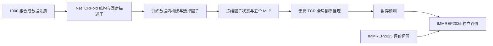

# 🧬 EvoTCR

## 基于因式分解与自进化范式的工业级 TCR–pMHC 结合推理引擎

[1000 组合成数据](https://huggingface.co/datasets/Tony1233/EvoTCR-1000-Refill212) · [冻结因子与五种子权重](https://huggingface.co/Tony1233/EvoTCR-Refill212-MLP) · [因子库](docs/FACTORS.md) · [训练协议与复现](docs/TRAINING.md) · [NetTCRFold](docs/NETTCRFOLD.md)

### 项目宣言 · 研究愿景

> 生命系统本质上是一个高维、非线性的混沌动力学系统。过去数十年，计算生物学要么受困于人类自然语言低效、模糊且无法定量的隐喻（如“疏水塌陷”、“锁钥匹配”、“构象诱导”），要么受困于端到端深度学习黑盒的不可解释性、灾难性遗忘与批次泄露假象。
>
> EvoTCR 开启 AI for Science 的全新范式：我们不依赖人类模糊语言对复杂机理的指代，而是将高维生物混沌解耦为数学上完全可溯源、正交解耦的物理与拓扑因子；同时，利用**“正交多指标头部效应”突破湿实验阳性样本获取壁垒，构建“生成模型 ⇄ 因子挖掘 ⇄ 极简轻量决策器”**持续沉淀、随时间单调变强的自进化生命周期。


## 数据来源与独立评估

**EvoTCR 的整个开发流程均基于 1000 组合成数据构建，包括数据构建与筛选、因子定义与选择、因子组合、超参数选择及模型拟合。**


IMMREP2025 结果报告的是从合成训练数据到外部实验基准的泛化表现。该结论的评估范围是当前固定靶点与 HLA 面板。


## 安装与快速开始

```bash
git clone --recurse-submodules https://github.com/JinQingshuo/EvoTCR.git
cd EvoTCR
python -m venv .venv
source .venv/bin/activate
pip install -e '.[inference,hub,structure,dev]'
evotcr --help
evotcr factors list
pytest
```

支持 Python 3.11/3.12，发布依赖限定 NumPy 1.x 与 PyArrow 16.x。冻结因子和 MLP 可在 CPU 上推理；NetTCRFold 为独立的 GPU/Apptainer/SLURM 结构预测流程。

### 下载权重并推理

```bash
python scripts/download_release.py --model
# query.npz 的 F/base/D/g/h 输入要求见 docs/INFERENCE.md。
evotcr predict-all weights/refill212 query.npz predictions-five.npz
```

下载器使用 [发布锁定文件](registries/release.json) 中的 Hugging Face 固定 commit，并验证 SHA256。权重包包含五个 MLP 头及完整的训练参考、PCA、核中心和回归系数。

### 下载与注册训练数据

```bash
python scripts/download_release.py --dataset
evotcr data validate data/refill212/DATASET.json data/refill212
evotcr data register data/refill212/DATASET.json
```

主数据包约 2.5 GB，含 30,000 条结构引用、29,940 份去重归档。全部原始 CIF、摘要及模型实际使用的数值输入均保留；主包不含完整 N×N 原始置信度矩阵。提取与重建需另留空间。文件清单和定位方法见 [数据说明](docs/DATASET.md)。

### 独立评价

```bash
# labels.npz 与 query 完全同行序，包含 y 与 g；标签只交给评价命令。
evotcr evaluate predictions-five.npz labels.npz evaluation.json
```

推理接口不接收标签。评价命令单独读取已生成的预测与标签，报告每个种子的指标、五种子均值和样本标准差。固定发布的训练记录与复现范围见 [训练说明](docs/TRAINING.md)。

## 工程结构与因子插件



| 模块 | 入口 | 职责 |
|---|---|---|
| 数据注册 | `data.py` | 数据角色、版本、来源与完整性校验 |
| 因子注册 | `factors/registry.py` | 唯一名称、版本、依赖 DAG、entry point 插件 |
| 描述子构建 | `structure/`、`integrations/` | 按配对计算固定几何与置信度描述子 |
| 参数管理 | `parameters.py`、`configs/frozen_*.json` | 校验发布因子组合与网络配置 |
| 冻结推理 | `inference.py`、`factors/runtime.py` | 共享计算、训练状态复用与完整面板校验 |
| 产物流水线 | `pipeline.py`、`artifacts.py` | 内容指纹、文件锁、原子清单与缓存校验 |
| 版本晋升 | `evolution.py` | 相同验证协议下的版本比较与晋升条件 |

因子通过 `Factor` 对象或 `evotcr.factors` entry point 注册，共享 PCA 等计算由惰性缓存复用。因子定义、拟合状态和推理调用相互分离。[因子库](docs/FACTORS.md) 说明每个因子的输入与训练依赖，[插件示例](examples/custom_factor.py) 展示独立扩展方法。发布模型固定使用完整 17 个因子；扩展模型需建立自己的版本和评估记录。


## NetTCRFold、权重与许可

NetTCRFold 上游源码以 Git submodule 固定在 `ae17ea27a8345c48046531463a49e90272bc33da`，配套三结构归档提取与置信度/几何适配器。[安装、输入、运行与权重说明](docs/NETTCRFOLD.md)。

- 本项目独立代码采用 [MIT](LICENSE)，复用描述子保留 [IMMREP FactorLab 的 MIT 声明](third_party/IMMREP_FACTORLAB_LICENSE)。
- NetTCRFold 上游各目录保留原许可，其中 `alphafold3_tcrpmhc` 为 CC BY-NC-SA 4.0。
- AlphaFold 3 权重须向 Google 官方申请，不在本项目分发；EvoTCR 权重包不包含 AF3 权重。
- 结构预测及其派生产物遵守 [AlphaFold 3 Output Terms of Use](third_party/ALPHAFOLD3_OUTPUT_TERMS.md)。

引用：Abramson, J. et al. *Accurate structure prediction of biomolecular interactions with AlphaFold 3*. Nature (2024), [doi:10.1038/s41586-024-07487-w](https://doi.org/10.1038/s41586-024-07487-w)。另请引用 [NetTCRFold 上游项目](https://github.com/mnielLab/NetTCRfold-1.0) 及所用数据、模型的固定 commit。
